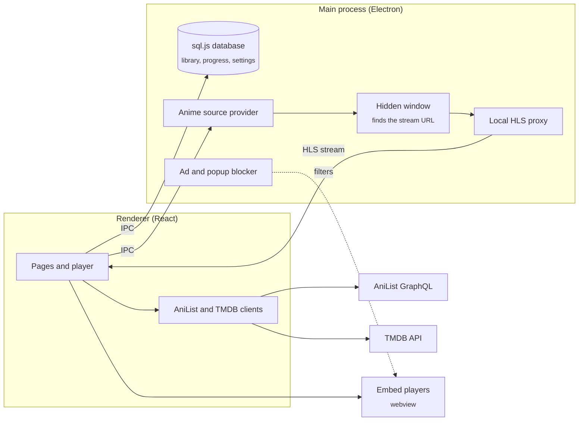

<div align="center">

# StreamWatch

**A desktop app to find, watch and track anime, movies and TV shows, and pick up where you left off.**

[](LICENSE)


</div>

StreamWatch puts browsing, watching and tracking in one app. Anime comes from [AniList](https://anilist.co), movies and TV from [TMDB](https://www.themoviedb.org), and your library and watch progress are stored locally on your computer, so the app always knows which episode you were on and how far into it you got.

## Features

- **Anime.** Browse trending, seasonal and popular anime, search by title, switch between sub and dub, and move on to the next episode automatically.
- **Movies and TV.** Discover trending and popular titles, filter by streaming service, genre or cast, watch trailers, and switch between several embed players with one click.
- **Library.** Sort anything into Watching, Plan to Watch, Completed, On Hold or Dropped, and mark episodes as watched.
- **Continue watching.** Saves the episode and timestamp so you can resume where you stopped.
- **Fewer ads.** A built-in blocker filters known ad domains and blocks popups and redirects from the embedded players.
- **Backup.** Export your library to a file and import it again, with or without your settings.
- **Personalisation.** Separate accent colours for the anime and the movies and TV sections.
- **Updates.** Installed builds check GitHub Releases for new versions and install them on quit.

## Install

Download the installer for your platform from the [Releases page](https://github.com/AlexMakesC0de/stream-watch/releases).

| Platform | File |
| --- | --- |
| Windows | `.exe` installer |
| macOS | `.dmg` |
| Linux | `.AppImage` or `.deb` |

The builds are a **beta** and are **not code-signed**, so your operating system will warn you the first time you open the app:

- **Windows:** SmartScreen shows "Windows protected your PC". Click **More info**, then **Run anyway**.
- **macOS:** Gatekeeper says the app cannot be opened because the developer cannot be verified. Right-click (or Control-click) the app in Applications, choose **Open**, then confirm. On recent macOS versions you may need to allow it under System Settings > Privacy & Security instead.
- **Linux:** make the AppImage executable first with `chmod +x StreamWatch-*.AppImage`.

### TMDB API key

The Movies and TV section needs a free TMDB API key. Create one at [themoviedb.org/settings/api](https://www.themoviedb.org/settings/api) and paste it in **Settings > Data Sources & APIs**. The key is stored in your local settings and never built into the app. Anime works without it.

## Build from source

You need [Node.js](https://nodejs.org/) (a current LTS version) and npm.

```bash
git clone https://github.com/AlexMakesC0de/stream-watch.git
cd stream-watch
npm install
npm run dev              # start the app with hot reload
```

For development you can put the TMDB key in a `.env` file as `VITE_TMDB_API_KEY=...` instead of entering it in Settings. This fallback only exists in development builds.

To build installers:

```bash
npm run package          # current platform
npm run package:win      # Windows (NSIS installer)
npm run package:mac      # macOS (.dmg and .zip)
npm run package:linux    # Linux (.AppImage and .deb)
```

Installers are written to `dist/`. The npm package is named `anime-watch`, its original name; the product name is StreamWatch.

## How it works



- **Metadata** is fetched by the renderer from AniList (GraphQL) and TMDB.
- **Anime playback:** the main process finds the episode on a streaming site, loads its player in a hidden window to capture the real video URL, and serves it through a local proxy so [hls.js](https://github.com/video-dev/hls.js) can play it. The match between an AniList ID and the site's page is cached.
- **Movies and TV playback** uses third-party embed players inside a webview, filtered by the ad blocker.
- **Storage** is a SQLite database run in-process with [sql.js](https://github.com/sql-js/sql.js), saved to the app's user data folder with a backup copy.

## Project structure

```text
src/
  main/              Electron main process
    index.ts         Window, IPC handlers, auto-updater, ad blocker
    database.ts      sql.js storage for library, progress and settings
    providers/       Anime source lookup and stream extraction
    proxy.ts         Local HLS proxy
  preload/           Safe bridge between main and renderer
  renderer/src/
    pages/           Hub, anime, movies and TV, library, watch and settings pages
    components/      Cards, rows, players, sidebar, tutorial
    services/        AniList and TMDB clients
electron-builder.yml Packaging targets and release settings
```

## Tech stack

Electron, React, TypeScript, Tailwind CSS, React Router, hls.js, sql.js, electron-vite and electron-builder.

## Disclaimer

StreamWatch does not host any content. It shows metadata from AniList and TMDB and plays streams from third-party sites. You are responsible for what you watch and for following the laws where you live.

## License

[MIT](LICENSE)
